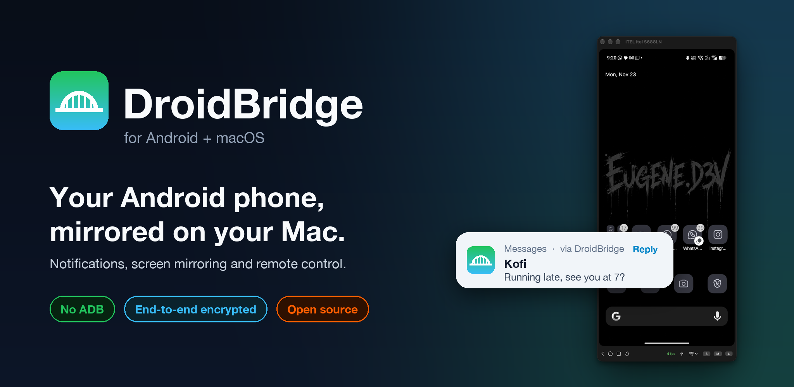
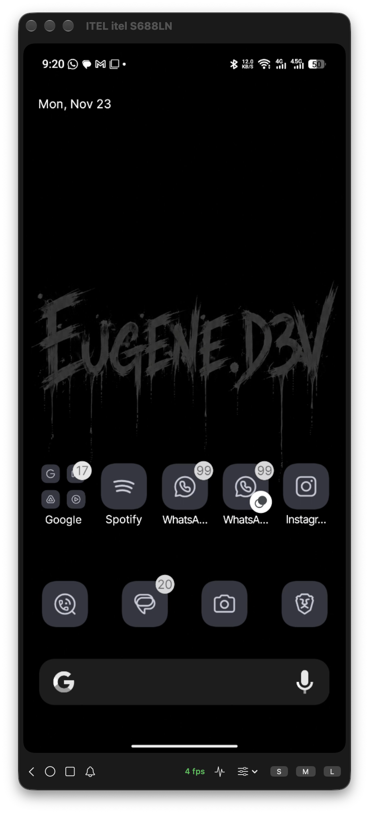
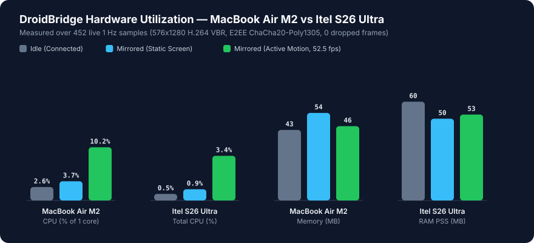
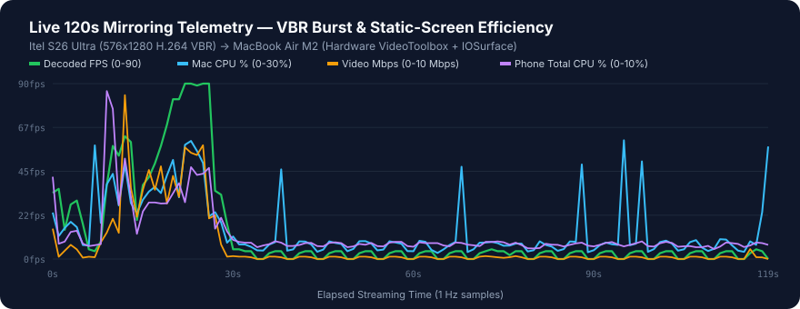
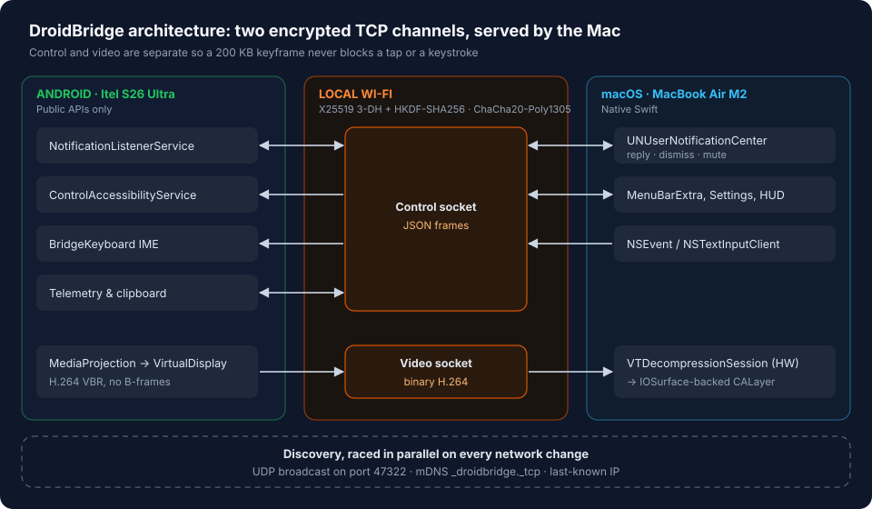

<p align="center">
  
</p>

<h1 align="center">DroidBridge</h1>

<p align="center">
  <b>Android ↔ macOS mirroring, remote control and notifications.</b><br/>
  An Apple "iPhone Mirroring"-style experience for Android, with <b>zero ADB, zero USB debugging, zero developer mode, zero root</b>, and <b>end-to-end encryption</b> on every byte after QR pairing.
</p>

<p align="center">
  <a href="https://github.com/eugene-sew/droidbridge/actions/workflows/ci.yml"></a>
  <a href="LICENSE"></a>
  
  
  
  
  <a href="CONTRIBUTING.md"></a>
</p>

<p align="center">
  
</p>

## Highlights

- **Two-Way Native Notification Sync:** Every Android notification (including SMS via your default SMS app, WhatsApp, etc.) appears natively in macOS Notification Center with inline reply, custom actions, per-app allow/mute list, privacy mode, and two-way dismiss.
- **Hardware-Accelerated Live Screen Mirroring:** Zero-B-frame H.264 VBR encoding on Android (`MediaProjection` + `MediaCodec`) streamed over encrypted TCP directly into Apple Silicon hardware **`VTDecompressionSession` → zero-copy `IOSurface`** rendering (~3 ms decode latency, 0 dropped frames).
- **Entire-Screen Default & Instant Standby Resume:** Uses Android 14+'s `MediaProjectionConfig.createConfigForDefaultDisplay()` (skipping the single-app picker) and keeps `MediaProjection` in zero-CPU standby (`mirror.pause`) when you close the Mac window so reopening resumes in <100 ms without repeat prompts.
- **Seamless Multi-Network Auto-Reconnect (Pair Once):** Races UDP LAN discovery (`47322`), Bonjour/mDNS (`_droidbridge._tcp`), and last-known IP in parallel. Switch Wi-Fi networks or restart either app — devices find each other and reconnect automatically without re-pairing.
- **Smooth Remote Control & Typing:** Continuous `GestureResultCallback`-chained touches & drags, trackpad scrolling, right-click Back, `DroidBridge Keyboard` IME (with Accessibility fallback), clipboard sync, and shortcuts (`⌘1` Home, `⌘2` Recents, `⌘[` / `Esc` Back, `⌘N` Notifications, `⌘V` Paste).
- **End-to-End Encrypted (X25519 + HKDF-SHA256 + ChaCha20-Poly1305):** Mutual authentication pinned at QR pairing; unknown devices and tampered frames are rejected immediately. Verified byte-for-byte with shared cross-platform test vectors in `protocol/test-vectors/`.

---

## Real-Hardware Performance Benchmarks

Measured over **501 live 1 Hz samples** across a real Wi-Fi LAN between an **Itel S26 Ultra** (`ITEL itel S688LN`, Spreadtrum UMS9360 8-core, 8 GB RAM, Android 15) and a fanless **MacBook Air M2** (`Mac14,2`, 8-core Apple M2, 16 GB RAM, macOS), running `Balanced` (`576×1280` H.264 VBR, E2EE ChaCha20-Poly1305):

<p align="center">
  
</p>

### MacBook Air M2 (`Mac14,2`, 16 GB RAM)

| Workload | Mac CPU (% of 1 core / total 8-core) | Physical RAM | Decoded FPS | VT Hardware Decode | Throughput | Control RTT | Thermal |
|---|---:|---:|---:|---:|---:|---:|---|
| **Idle (Connected, Notifications)** | **2.57%** (0.32% total) | **43.2 MB** | — | — | 0.00 Mbps | 25.3 ms | `nominal` |
| **Mirrored (Static Screen)** | **3.67%** (0.46% total) | **53.6 MB** | 2.7 fps | 3.83 ms | **0.08 Mbps** | 22.3 ms | `nominal` |
| **Mirrored (Active Motion)** | **10.19%** (1.27% total) | **45.5 MB** | **50.1 fps** (94 peak) | **2.96 ms** | **2.95 Mbps** (9.34 peak) | **14.9 ms** (7.0 min) | `nominal` |

### Itel S26 Ultra (`Spreadtrum UMS9360`, 8 GB RAM, Android 15)

| Workload | App CPU (Total / 1-Core) | App RAM (PSS) | ChaCha20 Encrypt | TCP Write | Battery Temp | Power Draw | Dropped Frames | Thermal |
|---|---:|---:|---:|---:|---:|---:|---:|---|
| **Idle (Connected)** | **0.50%** / 4.0% | 60.5 MB | — | — | 29.7°C | 1.57 W | 0 | `none` |
| **Mirrored (Static Screen)** | **0.86%** / 6.9% | 50.1 MB | 356 µs | 0.46 ms | 29.4°C | **0.97 W** | 0 | `none` |
| **Mirrored (Active Motion)** | **3.42%** / 27.3% | **52.6 MB** | **385 µs** | **0.44 ms** | **29.1–29.7°C** | **2.28 W** | **0** | `none` |

### Apple M2 CryptoKit Microbenchmark

| Operation | Latency | Throughput |
|---|---:|---:|
| Full 3-DH X25519 + HKDF-SHA256 handshake | **0.180 ms** | — |
| ChaCha20-Poly1305 decrypt (20 KB H.264 P-frame) | **30.6 µs/frame** | **638.1 MB/s** |
| ChaCha20-Poly1305 decrypt (150 KB H.264 IDR keyframe) | **226.1 µs/frame** | **647.9 MB/s** |

<p align="center">
  
</p>

> Full technical deep dive & write-up: **[docs/ARTICLE.md](docs/ARTICLE.md)** • Raw data: **[docs/benchmarks/results.md](docs/benchmarks/results.md)**

---

## Architecture

<p align="center">
  
</p>

Control and video run on **two independently encrypted TCP channels**, so a 200 KB keyframe never blocks a tap or a keystroke. The full wire and crypto spec is in [`protocol/PROTOCOL.md`](protocol/PROTOCOL.md).

### Repository layout

| Path | Contents |
|---|---|
| [`android/`](android/) | Kotlin + Jetpack Compose app: notification listener, accessibility control, IME, MediaProjection encoder |
| [`macos/`](macos/) | Swift / SwiftUI menu-bar app: server, VideoToolbox decoder, notification bridge (XcodeGen `project.yml`) |
| [`protocol/`](protocol/) | Wire protocol spec and shared crypto/framing test vectors |
| [`scripts/`](scripts/) | Build, LAN sideload, benchmark and screenshot tools |
| [`docs/`](docs/) | Technical write-up, benchmarks, screenshots, branding and development log |

---

## Prerequisites

- **macOS 14+** with Xcode 16+ and [XcodeGen](https://github.com/yonaskolb/XcodeGen) (`brew install xcodegen`)
- **JDK 17** and Android SDK (API 35)
- Optional: `brew install qrencode` (prints a terminal QR code when serving the APK)
- Both your Mac and Android phone on the **same Wi-Fi network**

---

## Quick Start (Under 15 Minutes, No USB Cable)

### 1. Build & Install the macOS App

```bash
./scripts/build-macos.sh
```

- By default, builds with ad-hoc local signing (`Sign to Run Locally`).
- For a free Apple ID Personal Team (optional, smoother macOS permission persistence):
  ```bash
  DEVELOPMENT_TEAM=YOUR_TEAM_ID ./scripts/build-macos.sh
  ```
- Install to `/Applications`:
  ```bash
  cp -R dist/DroidBridge.app /Applications/
  ```
- **First launch (Gatekeeper):** Right-click `/Applications/DroidBridge.app` → **Open** (or **System Settings → Privacy & Security → Open Anyway**), and allow **Local Network** and **Notifications**.

### 2. Build & Sideload the Android APK (No ADB)

```bash
./scripts/build-android.sh
```

- First run creates a release keystore at `~/.droidbridge/droidbridge-release.jks` (outside the repo). **Back up both the keystore and `~/.droidbridge/keystore.pass`** so future updates install directly over the top without uninstalling.
- Serve over your local Wi-Fi:
  ```bash
  ./scripts/serve-apk.sh
  ```
- Open the printed URL in Chrome on your phone (or transfer via Google Drive / Telegram Saved Messages), allow **"Install unknown apps"** for Chrome, and tap **Install**.

### 3. Complete Android Setup Checklist (No Developer Mode)

Open **DroidBridge** on your phone and walk through the 7-step Setup screen:

1. **Allow Notifications** (Android 13+).
2. **Allow Restricted Settings (Android 13+ sideloaded apps):** Tap **Open App Info** → **`⋮`** (top-right) → **Allow restricted settings**.
3. **Notification Access:** Enable **DroidBridge**.
4. **Accessibility Service:** Review the plain-language disclosure and enable **DroidBridge**.
5. **DroidBridge Keyboard (Optional):** Enable for smooth typing from your Mac.
6. **Battery Optimization Exemption:** Disable battery optimization for reliable background sync.
7. **Pair Once:** On your Mac menu bar click **DroidBridge → Pair New Phone…**, then scan the QR code on your phone.

---

## Mirror Window Controls & Shortcuts

| Input / Control | Action |
|---|---|
| Left click / drag / hold | Tap / smooth swipe / long-press |
| Two-finger scroll / wheel | Smooth vertical & horizontal scroll |
| Right-click | Back |
| `⌘1` / `⌘2` / `⌘[` or `Esc` / `⌘N` | Home / Recents / Back / Notification Shade |
| `⌘V` | Sync Mac clipboard to phone & paste |
| Waveform icon (bottom bar) | Toggle live Mac + Android hardware telemetry HUD |
| Sliders icon (bottom bar) | Switch live quality: **Fast (960p)** / **Balanced (1280p)** / **Sharp (1600p)** |
| `S` / `M` / `L` buttons | Aspect-ratio locked window size presets |

---

## Running Tests, Benchmarks & Screenshot Capture

```bash
# Shared crypto & framing test vectors (Android JUnit + macOS XCTest)
(cd android && ./gradlew :app:testDebugUnitTest)
(cd macos && xcodegen generate && xcodebuild test -project DroidBridge.xcodeproj -scheme DroidBridge -destination 'platform=macOS' CODE_SIGN_IDENTITY="-")

# Record & summarize live Mac + Android hardware telemetry
./scripts/benchmark.sh record 30     # live 30s run
./scripts/benchmark.sh summarize     # summarize all collected samples -> docs/benchmarks/

# Capture Retina screenshots & motion bursts of live DroidBridge windows
./scripts/capture-showcase.sh all    # mirror, settings, pairing windows -> docs/screenshots/
./scripts/capture-showcase.sh burst  # 6-frame motion burst
```

---

## OEM Background Survival Guide

- **Itel / Tecno / Infinix (HiOS / XOS / itel OS):** Open **Phone Master → Auto-start management** → enable DroidBridge; lock DroidBridge in Recents.
- **Xiaomi / Redmi / POCO (MIUI / HyperOS):** **App info → Autostart** ON + **Battery saver → No restrictions**.
- **Samsung (One UI):** **Settings → Battery → Background usage limits → Never sleeping apps** → add DroidBridge.
- More OEMs: [dontkillmyapp.com](https://dontkillmyapp.com).

---

## Known Platform Limitations

1. **Initial Android 14+ screen-capture approval:** Android requires a single one-tap "Start" confirmation after reboot or after you tap **End Capture**; thereafter, closing/reopening the Mac mirror window resumes instantly from zero-CPU standby with no prompt.
2. **Unlocked screen & `FLAG_SECURE`:** Mirroring requires an unlocked screen; banking/DRM apps marked `FLAG_SECURE` render black by Android security policy.
3. **Android 15+ OTP redaction:** Sensitive one-time passcodes redacted by Android are forwarded as received without workaround.
4. **Phone → Mac clipboard (Android 10+):** Syncs while `DroidBridge` or `DroidBridge Keyboard` is in the foreground; Mac → phone works anytime.
5. **macOS notification badge:** macOS displays DroidBridge's app icon as the primary notification badge; Android sender avatars and app icons appear as notification attachments.

---

## Contributing

Contributions, bug reports and device test results are welcome. Please read [CONTRIBUTING.md](CONTRIBUTING.md) first; it covers the project's hard constraints (no ADB, no Play Services, E2EE everywhere) and how to run the tests. Everyone taking part is expected to follow the [Code of Conduct](CODE_OF_CONDUCT.md).

Found a security issue? Please report it privately as described in [SECURITY.md](SECURITY.md).

## License

DroidBridge is released under the [MIT License](LICENSE).

DroidBridge is an independent project and is not affiliated with Apple or Google. "iPhone Mirroring" is used only to describe the experience it is inspired by.
