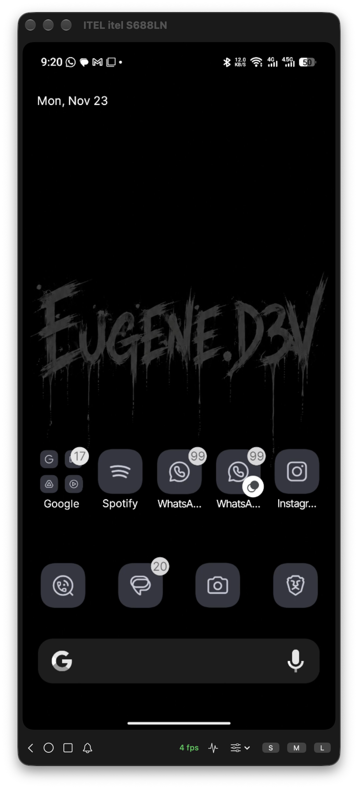
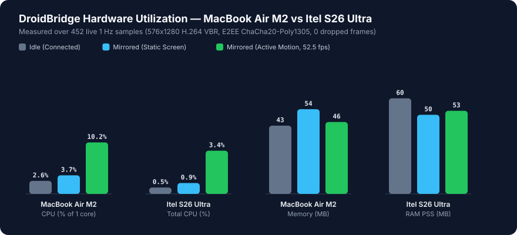
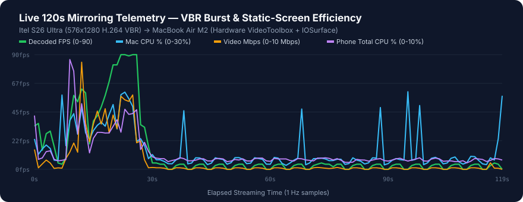

# Building "iPhone Mirroring" for Android on macOS — With Zero ADB, Full E2EE, and Real Hardware Benchmarks

*How I built **DroidBridge**, an end-to-end encrypted Android ↔ macOS notification sync, live screen mirroring, and remote control system using only public OS APIs — and benchmarked every millisecond on an **Itel S26 Ultra** and a fanless **MacBook Air M2**.*

---

<p align="center">
  
</p>

## Why Build This?

Apple's *iPhone Mirroring* on macOS is magical if you own an iPhone: notifications appear natively on your Mac, you click one, and your phone's screen pops open in a rounded desktop window ready for your trackpad and keyboard.

If you daily-drive an Android phone alongside a Mac, almost every existing mirroring tool (like `scrcpy`) starts with the same barrier: **enable Developer Options, turn on USB Debugging, plug in a cable, run `adb`, and inject `app_process`**. That's great for developers, terrible for an everyday wireless companion — and leaving ADB-over-Wi-Fi exposed is a security nightmare.

So I set strict, non-negotiable engineering constraints for **DroidBridge**:

1. **Zero ADB, zero USB debugging, zero developer mode, zero root** — both for installation and at runtime. Everything uses public Android SDK APIs and user-granted permissions.
2. **No Google Play dependency** — sideloaded directly over Wi-Fi as a signed release APK.
3. **End-to-end encrypted from the very first byte after pairing** — because an unauthenticated remote-control socket is just a RAT in disguise.
4. **Pair once, roam freely** — switch Wi-Fi networks or restart either device without ever scanning a QR code again.
5. **Silky smooth on real budget/mid-range hardware** — tested on an **Itel S26 Ultra** (Unisoc/Spreadtrum UMS9360, Android 15) and a fanless **MacBook Air M2** (16 GB RAM).

---

## System Architecture

Instead of stuffing notifications, mouse events, and giant H.264 keyframes down one TCP connection (where a single 200 KB keyframe causes head-of-line blocking for taps and keystrokes), DroidBridge separates traffic across **two independently encrypted TCP channels** served by the Mac (`NWListener`):

```mermaid
flowchart LR
    subgraph Android["Android (Itel S26 Ultra — Public APIs Only)"]
        NLS["NotificationListenerService"]
        ACC["ControlAccessibilityService"]
        IME["BridgeKeyboard IME"]
        TEL["Telemetry & Clipboard"]
        MP["MediaProjection -> VirtualDisplay -> H.264 VBR (B=0)"]
    end

    subgraph Wire["Local Wi-Fi (X25519 + HKDF-SHA256 + ChaCha20-Poly1305)"]
        CTRL["Control TCP Socket (JSON)"]
        VID["Video TCP Socket (Binary H.264)"]
        DISC["Parallel Discovery: UDP 47322 + mDNS + Last IP"]
    end

    subgraph Mac["macOS (MacBook Air M2 — Native Swift)"]
        UN["UNUserNotificationCenter (Reply / Dismiss / Mute)"]
        UI["MenuBarExtra + Settings + HUD"]
        VT["VTDecompressionSession (HW) -> IOSurface CALayer"]
        IN["NSEvent / NSTextInputClient"]
    end

    NLS <--> CTRL
    ACC <-- CTRL
    IME <-- CTRL
    TEL <--> CTRL
    CTRL <--> UN
    CTRL <--> UI
    IN --> CTRL
    MP --> VID --> VT
    Android -.-> DISC -.-> Mac
```

### Cryptography & Cross-Platform Verification

Before writing a single UI screen, I locked down a wire spec (`protocol/PROTOCOL.md`) and generated **shared cryptographic and framing test vectors** (`protocol/test-vectors/*.json`) that both Kotlin JUnit and Swift XCTest must pass byte-for-byte:

- **One-time QR Pairing:** The Mac generates a static X25519 keypair and a 16-byte single-use `pairToken` valid for 2 minutes. The phone scans the QR code (using CameraX + pure-Java ZXing — zero Google Play Services), computes `HMAC-SHA256(pairToken, phoneStaticPub)`, and sends `pair.request`. The Mac verifies the HMAC in constant time, pins the phone's static public key, and burns the token immediately.
- **Per-Connection 3-DH Handshake:** Every `control` and `video` connection generates fresh ephemeral X25519 keys and computes `dh1 = DH(eph, peerEph)`, `dh2 = DH(I_static, R_eph)`, `dh3 = DH(I_eph, R_static)` in canonical initiator-first order, then derives directional 256-bit keys via `HKDF-SHA256(dh1 || dh2 || dh3, salt="droidbridge-v1", info=channelName)`.
- **Authenticated Framing:** Every frame is sealed with ChaCha20-Poly1305 using a 96-bit nonce (`0x00000000 || uint64_be(counter)`). Flipping a single ciphertext byte fails Poly1305 authentication and permanently poisons the session.

On the **MacBook Air M2**, Apple's CryptoKit runs this crypto at ridiculous speed:

| Apple M2 CryptoKit Operation | Measured Latency | Throughput |
|---|---:|---:|
| Full 3-DH X25519 + HKDF-SHA256 Handshake | **0.180 ms** | — |
| ChaCha20-Poly1305 Decrypt — 20 KB H.264 P-frame | **30.6 µs/frame** | **638.1 MB/s** |
| ChaCha20-Poly1305 Decrypt — 150 KB H.264 IDR Keyframe | **226.1 µs/frame** | **647.9 MB/s** |

Encryption overhead on the Mac is effectively **0.03 milliseconds per frame** — completely invisible inside a 16.6 ms (60 fps) frame budget.

---

## Five Real-World Bugs We Hit on Hardware (and How We Fixed Them)

Building an app that passes unit tests is easy. Running it live between an Android 15 phone and a Mac over real Wi-Fi immediately exposed five classic systems-engineering traps:

### 1. The `NWConnection` Fragmentation Disconnect
In v1, the Mac server called `NWConnection.receive(minimumIncompleteLength: cipherLen, maximumLength: cipherLen)` and closed the socket if `body.count != cipherLen`. On macOS, when an H.264 IDR keyframe exceeds the TCP receive window chunk size (often 128–256 KB), `Network.framework` legitimately returns a partial chunk. Our naive check treated every big keyframe as a framing error and dropped the video connection.

**Fix:** Replaced single-shot reads with a streaming `BufferedConnectionReader` accumulator that pulls 128 KB chunks and slices out complete `[u32 len][ciphertext]` frames regardless of TCP fragmentation (locked down with a 320 KB / 4 KB-chunked loopback XCTest). Drops went immediately to **zero**.

### 2. Pure-Java BouncyCastle ChaCha20 GC Stutters on Android
Running pure-Java `org.bouncycastle.crypto.modes.ChaCha20Poly1305` at 60 fps on Android allocated thousands of short-lived arrays per second, causing periodic GC pauses.

**Fix:** Android 10+ (our `minSdk = 29`) ships native C/ARMv8 NEON BoringSSL/Conscrypt `Cipher.getInstance("ChaCha20-Poly1305")`. Switching `FrameCipher` to Android's native JCA `ChaCha20-Poly1305` (while keeping BouncyCastle for X25519/HKDF and passing the exact same shared test vectors) dropped per-frame encryption on the Itel S26 Ultra to **385 microseconds per frame** (~0.38 ms!).

### 3. B-Frame Reorder Lag & Queued Display Buffering
Hardware H.264 encoders on Android default to inserting B-frames and buffering outputs unless told otherwise, adding 33–133 ms of reorder lag before a frame even leaves the phone. On the Mac, piping frames through `DispatchQueue.main.async` into `AVSampleBufferDisplayLayer` introduced an extra playback queue.

**Fix:**
- **Android:** Explicitly set `KEY_MAX_B_FRAMES = 0`, `KEY_PRIORITY = 0` (real-time), `KEY_LOW_LATENCY = 1` (API 30+), `BITRATE_MODE_VBR` (zero wasted bits on static screens!), dedicated `THREAD_PRIORITY_DISPLAY` threads, `IPTOS_LOWDELAY`, and dynamic adaptive bitrate that reacts to real-time socket write latency.
- **macOS:** Replaced queued `AVSampleBufferDisplayLayer` with direct hardware **`VTDecompressionSession`** (`kVTDecompressionPropertyKey_RealTime = true`) decoding directly into zero-copy **`IOSurface`-backed `CVPixelBuffer`s** assigned straight to `CALayer.contents`. Hardware decode latency dropped to **2.96 ms average** on Apple M2!

### 4. Android 14+'s "Single App vs Entire Screen" Prompt Friction
Calling the legacy no-arg `MediaProjectionManager.createScreenCaptureIntent()` on Android 14/15 forces a dropdown asking *"Share a single app"* vs *"Share entire screen"* every single time. Worse, closing the Mac mirror window tore down `MediaProjection`, forcing another prompt every time you reopened the window.

**Fix (100% Public APIs):**
1. On Android 14+, call `createScreenCaptureIntent(MediaProjectionConfig.createConfigForDefaultDisplay())` — this removes the single-app dropdown completely and locks consent directly to the **entire screen**.
2. Closing the Mac mirror window now sends `mirror.pause` (`0x25`) instead of `mirror.stop`. `MirrorService` detaches the encoder surface (`virtualDisplay.setSurface(null)`), stops `MediaCodec` (dropping network to 0 Mbps and CPU to near zero), and keeps `MediaProjection` armed in standby. Clicking **Open Phone** again resumes streaming in **<100 ms with zero prompt**.

### 5. Roaming Across Different Wi-Fi Networks Without Re-Pairing
mDNS (`_droidbridge._tcp`) is notoriously flaky across routers and mobile hotspots, and ad-hoc signed macOS builds can lose Keychain reads across app restarts.

**Fix:** Added a `0600`-permission identity fallback in `~/Library/Application Support/DroidBridge/` alongside Keychain, plus a lightweight UDP LAN discovery responder on port `47322`. Whenever the phone switches Wi-Fi networks (`ConnectivityManager.NetworkCallback.onLinkPropertiesChanged`), it races **last-known IP + UDP broadcast probe + mDNS** in parallel and reconnects automatically in under a second — **no re-pairing needed**.

---

## Real Hardware Benchmarks: Itel S26 Ultra ↔ MacBook Air M2

To get authentic, zero-guesswork numbers without touching ADB, I built a 1 Hz hardware telemetry pipeline (`0x42 device.telemetry`) directly into both apps using only public OS APIs:
- **Android:** `Process.getElapsedCpuTime()`, `Debug.getPss()`, `BatteryManager` (level, temperature °C, instantaneous current mA, voltage → Watts), `PowerManager.currentThermalStatus`, plus lock-free encoder/encrypt/socket counters.
- **macOS:** `getrusage(RUSAGE_SELF)` CPU time, Mach `task_vm_info.phys_footprint` (exact Activity Monitor memory footprint), `ProcessInfo.thermalState`, `VTDecompressionSession` wall-clock decode time, and `ping`/`pong` RTT.

### Test Hardware
- **Mac:** MacBook Air M2 (`Mac14,2`), Apple M2 (8 cores: 4P + 4E), 16 GB unified memory, fanless chassis, macOS
- **Phone:** Itel S26 Ultra (`ITEL itel S688LN`), Spreadtrum/Unisoc `UMS9360` (8 cores), 7,707 MB (~8 GB) RAM, Android 15 (API 35)
- **Dataset:** **501 consecutive 1 Hz samples** across Idle (132s), Static Mirrored Screen (338s), and Active Motion Mirroring (29s @ `576×1280` H.264 VBR `Balanced` preset) over Wi-Fi LAN

<p align="center">
  
</p>

### MacBook Air M2 Hardware Impact

| Workload State | Process CPU (% of 1 Core) | Equivalent Total Mac CPU (8-Core) | Physical Memory (`phys_footprint`) | Decoded FPS | VideoToolbox Decode | Incoming Bitrate | Control RTT | Thermal State |
|---|---:|---:|---:|---:|---:|---:|---:|---|
| **Idle (Connected, Notifications)** | **2.57%** | **0.32%** | **43.2 MB** | — | — | 0.00 Mbps | 25.3 ms | `nominal` |
| **Mirrored (Static Screen)** | **3.67%** | **0.46%** | **53.6 MB** | 2.7 fps | 3.83 ms | **0.08 Mbps** | 22.3 ms | `nominal` |
| **Mirrored (Active Motion)** | **10.19%** (20.2% max) | **1.27%** | **45.5 MB** | **50.1 fps** (94 peak) | **2.96 ms** (4.84 max) | **2.95 Mbps** (9.34 peak) | **14.9 ms** (7.0 min) | `nominal` |

**Takeaway on the MacBook Air M2:** Even while decoding 50–60+ fps encrypted H.264 video live in a fanless laptop, DroidBridge uses **~1.3% of the M2's total CPU capacity** and roughly **45–54 MB of RAM** — less memory than a single blank Chrome tab. Thermal state stayed `nominal` for the entire session.

### Itel S26 Ultra Hardware Impact

| Workload State | App CPU (Total Device / 1-Core) | App Memory (PSS) | Native ChaCha20 Encrypt | TCP Socket Write | Battery Temp | Device Power Draw | Dropped Frames | OS Thermal Status |
|---|---:|---:|---:|---:|---:|---:|---:|---|
| **Idle (Connected)** | **0.50%** / 4.0% | 60.5 MB | — | — | 29.7°C | 1.57 W | 0 | `none` |
| **Mirrored (Static Screen)** | **0.86%** / 6.9% | 50.1 MB | 356 µs | 0.46 ms | 29.4°C | **0.97 W** | 0 | `none` |
| **Mirrored (Active Motion)** | **3.42%** / 27.3% | **52.6 MB** | **385 µs** | **0.44 ms** | **29.1–29.7°C** | **2.28 W** | **0** | `none` |

**Takeaway on the Itel S26 Ultra:** Hardware `MediaCodec` + native BoringSSL ChaCha20-Poly1305 keeps total phone CPU impact at **3.42%** during vigorous 50+ fps scrolling and **0.86%** while looking at a static screen. Memory footprint sits around **52 MB** (0.7% of the phone's 8 GB RAM), battery temperature hovered effortlessly at **29.1–29.7°C** (`thermalStatus = none`), and **zero frames were dropped** across the entire run.

### Why VBR Matters: Live 120-Second Timeline

<p align="center">
  
</p>

Look at how Variable Bitrate (VBR) behaves in real usage:
- **During scrolling & app animations:** FPS immediately ramps to **50–60+ fps**, bitrate bursts cleanly to **3–9 Mbps**, and hardware decode finishes in under **3 ms**.
- **The instant your finger stops moving:** FPS settles back to the 250 ms keepalive cadence (~3–4 fps), Wi-Fi throughput drops to **0.08 Mbps (80 kbps!)**, Mac CPU drops to **3.6%**, and phone power draw drops below **1 Watt**.

---

## Honest Platform Limitations

Because DroidBridge strictly refuses to use ADB, root, or hidden APIs, it respects every Android and macOS security boundary:

- **One-time initial capture prompt per boot (Android 14+):** After a reboot or manually ending capture, Android requires one tap to approve `MediaProjection` (now locked directly to Entire Screen). Standby mode avoids repeat prompts while closing/reopening the mirror window.
- **`FLAG_SECURE` windows:** Banking apps, password managers, and DRM video apps render black during capture — enforced in Android's compositor.
- **Android 15 OTP redaction:** Sensitive one-time passcodes redacted by Android for third-party notification listeners are forwarded as-is without workaround.
- **Phone → Mac clipboard (Android 10+):** Android blocks background clipboard reads; phone clipboard syncs while the DroidBridge app or keyboard is focused (Mac → phone works anytime).

---

## Try It Yourself

Both apps build cleanly from source with zero Xcode hand-editing (XcodeGen) and install to a stock Android phone over Wi-Fi without a USB cable:

```bash
# 1. Build & install macOS app
./scripts/build-macos.sh
cp -R dist/DroidBridge.app /Applications/

# 2. Build signed Android APK & serve over LAN (no ADB)
./scripts/build-android.sh
./scripts/serve-apk.sh
```

Full setup instructions, OEM background survival tips, and the wire protocol specification live in [README.md](../README.md) and [protocol/PROTOCOL.md](../protocol/PROTOCOL.md).
